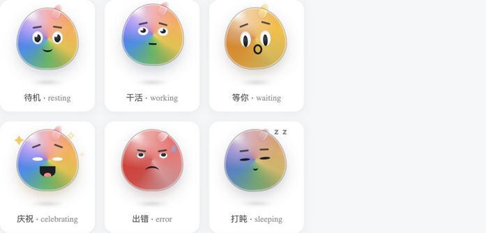
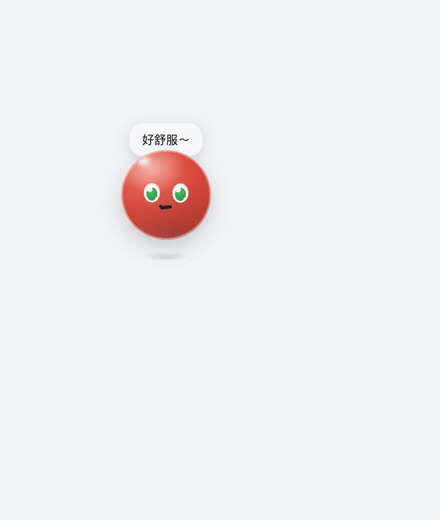
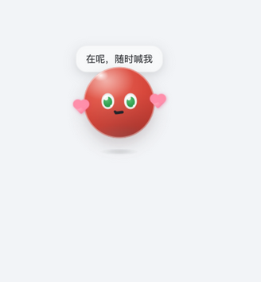

<div align="center">

# dsh-ui-rainbowspeak

<p align="center"><b>RainbowSpeak</b> (虹语) — a flowing rainbow border for the chat composer, plus <b>Prism</b>, a rainbow droplet companion that lives in the window: it watches your pointer, waits when you must confirm, and only celebrates when a turn really finished.</p>

<p align="center">
  <a href="https://github.com/kenz1117/dsh-ui-rainbowspeak/stargazers"></a>
  <a href="https://www.npmjs.com/package/@kenz1117/dsh-ui-rainbowspeak"></a>
  <a href="https://www.npmjs.com/package/@kenz1117/dsh-ui-rainbowspeak"></a>
  <a href="https://github.com/kenz1117/dsh-ui-rainbowspeak/blob/main/LICENSE"></a>
  <a href="https://github.com/kenz1117/dsh-ui-rainbowspeak/pulls"></a>
  <a href="https://github.com/kenz1117/dsh-ui-rainbowspeak"></a>
  <a href="https://github.com/kenz1117/dsh-ui-rainbowspeak/graphs/contributors"></a>
  <a href="https://awesome-dsh-plugin.com"></a>
</p>

[中文](README.md) · [English](README.en.md)

</div>

---

<div align="center">
  
</div>

<div align="center">
  
</div>

<div align="center">
  
</div>

## ✨ Why this one

### Pure decoration, zero intrusion

No slots taken over, no host patches, no tools registered, no system-prompt injections. The rainbow ring is pure browser-side decoration: a `conic-gradient` ring masked down to the card edge, rotated by a registered custom property. Engines without `@property` degrade to a static gradient ring.

The pet keeps the same promise: the only host-side addition is a **read-only** stream of turn boundaries (session identity, turn sequence, end reason) that carries **no chat content, no history, and no approval details**; the browser side only adds one floating entry to `shell.overlay` and changes nothing else in the host.

### The border, plus a little companion in the window

Besides the border, the plugin ships **Prism** — a rainbow droplet pet that lives inside the DSH window. Drag it around, it remembers where you left it, it sits on the frame-wide `shell.overlay` layer, and it has six moods: resting, working, waiting on you, celebrating, error, and napping.

Prism's **success and failure follow the host's authoritative turn boundaries** (a read-only `session/event` stream delivered over a Typert remote): a cancelled turn never celebrates, because celebrating a cancelled turn is a lie. When that stream is unavailable the pet falls back to the client's own session state for "running / waiting on you" — and stays quiet about outcomes it cannot know.

### A pet that watches you

- **Its eyes follow your pointer** — the pupils drift a little (capped at 4.5 px, so they never leave the eye). Leave the pointer still for a few seconds and the gaze wanders on its own — random saccades at irregular intervals, like a mind of its own.
- **Poke it** — it squashes and springs back, says one of five rotating lines, and a few hearts pop out.
- **Double-poke it** — it spins a full turn, then sees ×_× for a moment.
- **Press and hold** — that's a pat: a jelly inflate, happy closed eyes, full blush.
- **Poke it while it naps** — a startle: it bounces up with a shiver, instantly awake.
- **Drag it** — it tilts with your momentum, like it's dangling from your fingertip; letting go earns a little landing bounce.
- **Leave it alone long enough** — it hums itself a tune, ♪ notes floating out (random 36–60 s cooldown).
- **Every appearance** — a random entrance animation: pop in / drop in / spin in / hop in.
- **Right-click** (or press `Shift+F10`) for a small menu: watch scope / size / let it hide.
- **Its lines rotate** — two per state, so it never repeats itself.
- **It notices its environment** — resizing the window makes it stumble, waking up earns you a stretch, and scrolling the chat pulls its gaze along with the content. It lives in the window; it isn't stuck on it.
- **Three animation intensities** — full / subtle / off. Subtle keeps every reaction but tones down the amplitude; off keeps only expression changes. The OS-level reduced-motion preference always wins.
- **Glass-drop rendering, pure CSS** — a droplet tip (ahoge) on the head that changes color and posture per state, five layers of light (main reflection, star dot, top skylight, bottom shade, ground bounce), and a radially fading ground shadow that shrinks with every celebration jump (secondary action).

### The border is the session state

The ring mirrors the live session: it speeds up while the agent is running (4 s → 1.2 s per loop), turns amber with a slow pulse while a tool approval or ask-user prompt is pending, turns red with a fast pulse on send failures or agent errors, and plays a one-loop celebrate flash when a turn completes. You always know where the agent is without watching the screen.

### Seven palettes, one that follows your theme

Classic rainbow / aurora / sunset / peach / ocean / cyberpunk neon — plus *follow theme*, derived from the host brand token via `color-mix`, tracking light/dark switches instantly.

## 🌈 Features

- **Rainbow marquee border** around the composer card (`[data-composer-card]` host anchor), flowing via a registered `@property` angle so the gradient genuinely animates. Engines without `@property` degrade to a static gradient ring.
- **Desktop pet "Prism"**: sits on `shell.overlay` (the frame-wide floating layer the host recommends for draggable overlays), draggable, with a persisted position and a greeting bubble on tap. Drawn entirely in CSS geometry — **no external assets**, hence no third-party artwork licensing question.
- **It interacts**: pupils track your pointer, a poke squashes it and pops hearts, dragging makes it swing with your momentum, and right-click (or `Shift+F10`) opens a small menu (watch scope / size / hide).
- **Six moods**: resting (breathing + sway), working (focused squint + nodding), waiting (amber, vertical pupils, raised brows), celebrating (bounce + sparkles + big grin + tongue), error (red, sweat drop, rueful grimace), and napping (closed eyes, Zzz — it falls asleep after two idle minutes). The face itself (sclera/pupil/double glints, brows, mouth shape, blush) changes per state.
- **Authoritative turn boundaries**: the host half contributes a read-only event stream over Typert (`remote.rainbowPet/watch`); the browser half validates every frame against the same Zod schema before trusting it, and reconnects on a sequence gap rather than acting on half a state.
- **Settings panel** (`Settings` → `Rainbow border`): enable/disable, flow speed (1–10 s per loop), ring width (1–6 px), color scheme, placement (all sides / top / bottom), reverse flow, and a breathing brightness overlay — plus a **desktop pet** group: show the pet, watch scope (all sessions / current session), animation intensity (full / subtle / off), and pet size (0.6–1.6×). All preferences persist in `localStorage` and apply live.


  
- **Prism in a real host**:

  
- **Seven color schemes**: classic rainbow, aurora, sunset, peach, ocean, cyberpunk neon (cyan/violet/magenta with a white lamp-flash segment), and *follow theme* — derived from the host brand token via `color-mix`.
- **Session-state awareness** via the host dock seat: the ring speeds up while the agent is running (4 s → 1.2 s per loop), turns amber with a slow pulse while a tool approval or ask-user prompt is pending, turns red with a fast pulse on send failures or agent errors, and plays a one-loop celebrate flash when a turn completes. Priority: error > attention > running.
- **Focus boost**: the ring brightens and saturates while the composer has focus, easing back on blur.
- **Accessibility**: honors `prefers-reduced-motion` (animations disabled, static ring kept); settings controls carry localized labels and aria attributes.
- **Bilingual copy** (zh/en) through the host locale registry; follows the host language setting.

## 🎨 Palettes

| Cyberpunk neon | Aurora | Sunset |
| --- | --- | --- |
|  |  |  |

**Follow theme** (light mode): the ring takes the host brand color and tracks theme switches instantly.


## 📦 Install

From the dsh CLI:

```sh
dsh plugin add @kenz1117/dsh-ui-rainbowspeak
```

Or add it to a profile `package.json` manually:

```json
{
  "dependencies": {
    "@kenz1117/dsh-ui-rainbowspeak": "*"
  }
}
```

For local development, point the dependency at a checkout:

```json
{
  "dependencies": {
    "@kenz1117/dsh-ui-rainbowspeak": "link:/absolute/path/to/dsh-ui-rainbowspeak"
  }
}
```

then run `pnpm install` in the profile directory and restart the host. With the `link:` form, `pnpm bundle` in the plugin repo is enough for the next host restart to pick changes up — no reinstall needed.

## ⚙️ How it works

- The plugin mounts a single `<style data-plugin>` stylesheet on apply and removes it on dispose (effect lifecycle).
- `::before` on the composer card paints a `conic-gradient` covering the full color wheel; a `mask` composite cuts out the interior so only the edge band remains, rounded to the card radius. Ring width and flow period are consumed from `--dsh-rainbow-*` variables.
- `--dsh-rainbow-angle` is registered as `<angle>` via `@property`, which is what makes the gradient's start angle interpolable; the keyframes rotate it 360°.
- User preferences and session state are projected onto `<html>` as `data-rainbow-*` attributes and inline CSS variables, so every toggle applies instantly without rebuilding the stylesheet.
- The state bridge reads the host session seat and the global pending-interaction seat (approval/ask-user) — plugin-level only, no agent-loop involvement.
- The pet's **host half** provides a read-only `rainbowPet` service: it listens for `turn/start` / `turn/end` on `session/event` and projects only boundary metadata (session identity, turn sequence, end reason) — no history, no content, no approvals. It contributes that contract through the `./typert` subpath.
- The pet's **browser half** mounts the same contract via `ctx.remote.$mount()`, then injects the `remote.rainbowPet` namespace and consumes the stream. Every frame is validated against the host's own Zod schema, and frame sequence numbers must be contiguous — a gap triggers a backed-off reconnect.
- When the remote runtime (API Gateway) is absent the pet degrades quietly: it still reads "running / waiting on you" from the client session state, and stays silent about outcomes it cannot know.

## 🛠 Development

```sh
pnpm install        # deps (peers link into the monorepo checkout via scripts/link-peers.mjs)
pnpm test           # vitest suite (node half, preferences clamping, state projection, pet state machine, bundle smoke)
pnpm typecheck      # tsc --noEmit
pnpm bundle         # tsdown: lib/index.js + lib/remote.js + lib/typert.host.js (node half) + lib/client.js (browser IIFE)
pnpm preview        # regenerate preview/pet-states.html: an offline sheet of the six moods
```

The `client` half is a self-contained IIFE injected into the host web client; the `node` half carries the rainbow state bridge and the pet's read-only boundary service, and exports the `./typert` host-face manifest.

`preview/pet-states.html` needs no host: it inlines `src/client/pet.module.css` verbatim next to six static markups. Run `pnpm preview` after a CSS change and open it in a browser to compare all six moods at once — far quicker than clicking through the real host.

## 🤝 Compatibility

- Client platform: `web` (desktop/web host renders). Requires `@property` support for the flowing animation (all Chromium/Electron builds fine); other engines show a static ring.
- Peer: `@deepseek-ai/cordis` (provided by the host at runtime).
- The pet needs host support for Typert (`@deepseek-ai/dsh-typert-loader`) and the client Remote runtime. Without them the plugin still loads, and the pet degrades to "client session state only".


## 📄 License

[MIT](https://github.com/kenz1117/dsh-ui-rainbowspeak) © 2026 KenZ (kenz1117)
