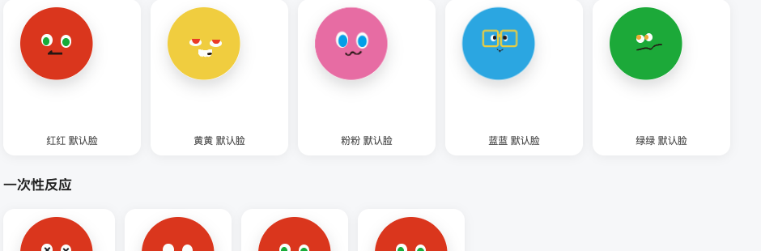

<div align="center">

# dsh-ui-rainbowspeak

<p align="center"><b>RainbowSpeak</b> (虹语) — a flowing rainbow border for the chat composer, plus <b>Prism</b> (小虹), a ba-ji-ball companion that lives in the window: five candy balls to pick from (red / yellow / pink / blue / green), replicated pixel-by-pixel from the reference art, watching your pointer, waiting when you must confirm, and only celebrating when a turn really finished.</p>

<p align="center">
  <a href="https://github.com/kenz1117/dsh-ui-rainbowspeak/stargazers"></a>
  <a href="https://www.npmjs.com/package/@kenz1117/dsh-ui-rainbowspeak"></a>
  <a href="https://www.npmjs.com/package/@kenz1117/dsh-ui-rainbowspeak"></a>
  <a href="https://github.com/kenz1117/dsh-ui-rainbowspeak/blob/main/LICENSE"></a>
  <a href="https://github.com/kenz1117/dsh-ui-rainbowspeak/pulls"></a>
  <a href="https://github.com/kenz1117/dsh-ui-rainbowspeak"></a>
  <a href="https://github.com/kenz1117/dsh-ui-rainbowspeak/graphs/contributors"></a>
  <a href="https://awesome-dsh-plugin.com"></a>
</p>

[中文](README.md) · [English](README.en.md)

</div>

---

<div align="center">
  
</div>

<div align="center">
  
</div>

<div align="center">
  
</div>

## ✨ Why

### Pure decoration, zero intrusion

No slots taken over, no host patches, no tools registered, no system prompts injected. The rainbow ring is pure browser-side decoration: a `conic-gradient` circle masked down to the card edge, carried by a **rotating layer** — the gradient paints once, then the compositor spins it; the main thread never repaints per frame.

The pet obeys the same boundary: the host side adds only a **read-only** turn-boundary stream (session id + turn index + end reason), carrying **no chat content, history, or approval details**; the browser side mounts one floating entry on `shell.overlay` and touches nothing else in the host UI.

### Five balls, five characters, replicated pixel-by-pixel

The five balls are **not** one character in five colors — they are five independent characters: Hong-Hong (tsundere, cool), Huang-Huang (lazy, half-lidded), Fen-Fen (derpy, big-eyed), Lan-Lan (rational, bespectacled), Lyu-Lyv (grumpy, cross-eyed). Every face is **measured and replicated pixel-by-pixel** from the reference art (`tools/anim-bench/scan-faces-precise.mjs`, connected components + scanlines, part accuracy ≤0.5% of face width): flat-filled bodies, mouths as scanline-derived `clip-path` polygons, Huang-Huang's two-layer "white eyeball + red lid", Lan-Lan's frames scaling with body size. Every circle carries a `longhand + !important` hardening contract — host-wide global styles cannot reshape them.

Success and failure follow the host's **authoritative turn boundary** (via the Typert remote reading `session/event` `turn/end`): a cancelled turn never gets celebrated — celebrating a cancel would be lying. Without the remote runtime the pet quietly degrades to client-session-only moods, never inventing conclusions.

### A pet that interacts

- **Eyes follow the pointer**: pupils glide (capped at 5% of body width, further damped per character — the smallest eye-whites get the smallest gain; pupils never slide off the whites), always gliding, never jumping; after a few idle seconds they wander on their own and drift back; the body leans ~1° toward its own gaze;
- **Poke**: a squash-and-rebound with a "jelly afterquiver" (damped tail, volume-preserving), a spoken line, and two or three candy hearts popping from **above the head**;
- **Rapid pokes (double-click)**: a full spin, then a dizzy ×_× moment;
- **Press and hold**: a pat — jelly bulge, happy squint, blush;
- **Poke while napping**: a startle — it springs up, fully awake;
- **Drag**: it leans with inertia like hanging from your fingertip, with a landing bounce on release;
- **Left idle**: it hums a tune, ♪ notes floating out (random 36–60 s cooldown);
- **Every entrance**: a random intro — pop / airdrop (shadow lands first) / spin / hop;
- **Right-click** (or `Shift+F10`): a small menu — character / scope / size / hide;
- **Environment-aware**: stumbles when the window resizes, stretches on waking, glances at scrolling chat — living in the window, not pasted on it;
- **Motion levels**: full / gentle / off — gentle keeps every reaction with reduced amplitude; off keeps expressions only (system `prefers-reduced-motion` always wins).

### The border is the session state

The ring reflects the conversation in real time: faster while the agent runs (4 s → 1.2 s/turn); amber slow-pulse while a tool approval or question awaits you; red fast-pulse on failures; a one-cycle celebratory flash when a turn completes. Peripheral vision is enough to know where things stand.

### Seven palettes, theme-following included

Classic rainbow / aurora / sunset / peach / ocean / cyberpunk — plus **follow-theme**, derived from the host brand color via `color-mix`, following light/dark switches instantly.

## 🎭 The five characters

| Character | Eyes | Mouth | Idle motion | Temper |
| --- | --- | --- | --- | --- |
| **Hong-Hong** (red) | Round white eyes, green iris | Solid left-pointing wedge + bar | Sharp nods | Tsundere, cool |
| **Huang-Huang** (yellow) | White eyeball + red half-lid | White grin + mouth-corner bean | Lazy pendulum | Lazy, aloof |
| **Fen-Fen** (pink) | Big vertical whites, blue iris (cross-eyed) | Wavy stroke | Bounce (squash & stretch) | Derpy, sweet |
| **Lan-Lan** (blue) | Yellow square frames (size-scaled), dark pupils | Thick V | Metronome breathing | Rational, earnest |
| **Lyu-Lyv** (green) | Jammed-together small whites, orange iris (overhanging) | Low-left-to-high-right zigzag | Impatient twitch | Grumpy |

Six states (resting / working / waiting / celebrating / error / sleeping) get a character-specific take on each ball: Huang-Huang's lid presses lower while working and the pupil peeks out while waiting; Lan-Lan's frames keep their shape while sleeping and while blinking. State switches tween via `scale` / `translate` — expressions *become*, they don't snap.

## 🌈 Features

- **Rainbow marquee border**: flowing ribbon around the composer card, driven by a rotating layer — **measured repaints per frame: 360 → 0**.
- **Desktop pet "Prism"**: lives on `shell.overlay`, draggable with persisted position; pure CSS geometry, **zero external assets**, therefore no third-party-character licensing concerns.
- **Five selectable characters** (context menu or settings): ball color is identity, expressions change with state — five base faces + 25 dedicated keyframe sets (five states × five characters), each with its own motion language.
- **Interaction details**: jelly-afterquiver poke rebound, candy hearts from above the head (2–3, auto-throttled when spam-poked), inertial drag sway, pointer-following pupils + random saccades + gaze lean.
- **Authoritative turn boundary**: the host half contributes a read-only event stream (`remote.rainbowPet/watch`); the browser half validates every frame with the same Zod schema, requires contiguous sequence numbers, and backs off on gaps.
- **Host-style hardening**: every circle (body / eyes / pupils / hit area / aura) is pinned with longhand radii + `!important` — host-wide `button span` rules cannot deform them; frame stroke width uses container-query units, scaling with pet size, with a fixed-width fallback on older engines.
- **Settings panel** (`Settings` → `Rainbow border`): enable, speed, width, palette, edge, reverse flow, breathing glow; a **Desktop pet** group: enable, character, scope, motion level, size (0.6–1.6×). All preferences persist in `localStorage`, effective immediately.

  

- **Under simulated host conditions** (host-like global rules applied — see [`preview/pet-client-sim.html`](preview/pet-client-sim.html)):

  

- **Seven palettes**: classic rainbow, aurora, sunset, peach, ocean, cyberpunk, and **follow-theme** (`color-mix` from host brand tokens).

  | Cyberpunk | Aurora | Sunset |
  | --- | --- | --- |
  |  |  |  |

- **Follow-theme** (light mode): the border takes the host brand color and follows theme switches instantly.

  

- **Session awareness**: the ring speeds up while running; amber slow-pulse while waiting for approvals/questions; red fast-pulse on errors; a celebratory flash on turn completion. Priority: error > attention > running.
- **Focus glow**: the ring brightens while the composer is focused, easing back on blur.
- **Accessibility**: honors `prefers-reduced-motion` (animations disabled, static ring and expressions kept); localized labels and aria attributes on all controls.
- **Bilingual**: copy is served through the host locale registry and follows the host language.

## 📦 Install

Via the dsh CLI:

```sh
dsh plugin add @kenz1117/dsh-ui-rainbowspeak
```

Or add it to your profile's `package.json`:

```json
{
  "dependencies": {
    "@kenz1117/dsh-ui-rainbowspeak": "*"
  }
}
```

For local development, point the dependency at a checkout:

```json
{
  "dependencies": {
    "@kenz1117/dsh-ui-rainbowspeak": "link:/absolute/path/to/dsh-ui-rainbowspeak"
  }
}
```

Then run `pnpm install` in the profile directory and restart the host. With the `link:` form, running `pnpm bundle` in the plugin repo is enough — the host picks up changes on its next restart, no reinstall needed.

## ⚙️ How it works

- The plugin mounts a single `<style data-plugin>` stylesheet on apply and removes it on dispose (effect lifecycle).
- The composer card's `::before` paints the `conic-gradient`; `mask` compositing keeps only the edge ring; the color layer is a square conic gradient rotating 360° around the card center — no `@property` angle interpolation needed.
- Preferences and session state project onto `<html>` `data-rainbow-*` attributes and inline CSS variables — every switch is immediate, no stylesheet rebuild.
- The pet's **host half** provides a read-only `rainbowPet` service listening to `turn/start` / `turn/end`, projecting boundary metadata only; the **browser half** consumes it via `ctx.remote.$mount()`, validating every frame with the same Zod schema, checking sequence continuity, and backing off on gaps.
- The pet itself is pure CSS geometry (no images, no canvas): mouths are `clip-path` polygons derived from reference-art scanlines; animation uses only `scale` / `translate` / `rotate` compositing-friendly properties — **zero repaints per frame**; state switches never trigger layout.
- The look is fully hardened against host styles and size changes: circles pinned with longhand + `!important`, frame stroke in `cqw` scaling with body size (fixed-px fallback on older engines), gaze following proportional to body width and damped per character.

## 🛠 Development

```sh
pnpm install        # deps (peers linked via scripts/link-peers.mjs for monorepo checkouts)
pnpm test           # vitest suite (node half, pref clamping, state projection, pet state machine, bundle smoke)
pnpm typecheck      # tsc --noEmit
pnpm bundle         # tsdown: lib/index.js + lib/remote.js + lib/typert.host.js (node half) + lib/client.js (browser IIFE)
pnpm preview        # generates two previews: pet-states.html (5 characters × 6 states matrix)
                    #                    pet-client-sim.html (host-condition sim: host rules + pointer gaze + 3 sizes)
pnpm bench:anim     # animation bench: Paint / style recalc / layout metrics
pnpm bench:pet-visual      # six-state visual regression (pixel-level)
```

The replica toolchain (`tools/anim-bench/`): `scan-faces-precise.mjs` pixel-precise reference measurement (connected components + scanlines), `scan-runs.mjs` targeted full-run color segments, `mouth-poly.mjs` scanlines → `clip-path` polygons, `compare-faces.mjs` reference-vs-impl-vs-diff triptychs, `measure-grid.mjs` gridded reading sheets, `measure-implementation.mjs` dual-caliber DOM re-measurement. Specs and findings live in [`docs/character-design.md`](docs/character-design.md).

## 🤝 Compatibility

- **Host**: dsh desktop/web hosts; tested against **0.2.x** (`engines.dsh >= 0.1.2-alpha.1` is the floor). Peer: `@deepseek-ai/cordis` (provided by the host runtime).
- **Engine**: Chromium/Chrome **≥ 105** for the full experience (container-query units, `@property`-driven blinking). Older engines degrade gracefully: frame stroke falls back to a fixed 2.1px, blinking falls back to whole-eye squashing — expressions and palettes are unaffected.
- **Pet remote**: needs Typert + client Remote runtime support; without them the plugin still loads and the pet degrades to client-session-only moods.
- **Accessibility**: `prefers-reduced-motion` honored at all tiers.

## 📄 License

[MIT](https://github.com/kenz1117/dsh-ui-rainbowspeak) © 2026 KenZ (kenz1117)
